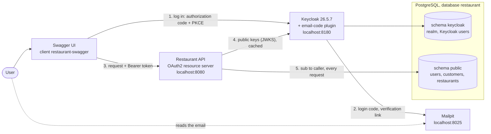
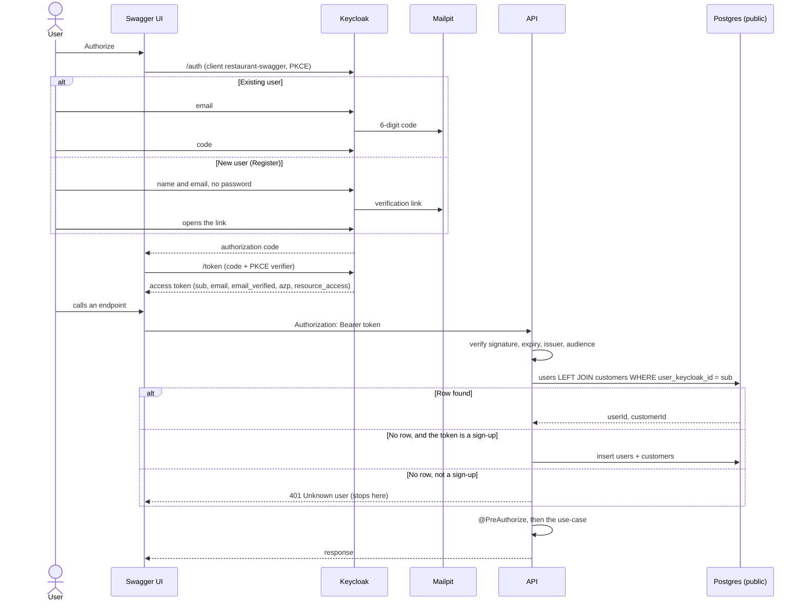
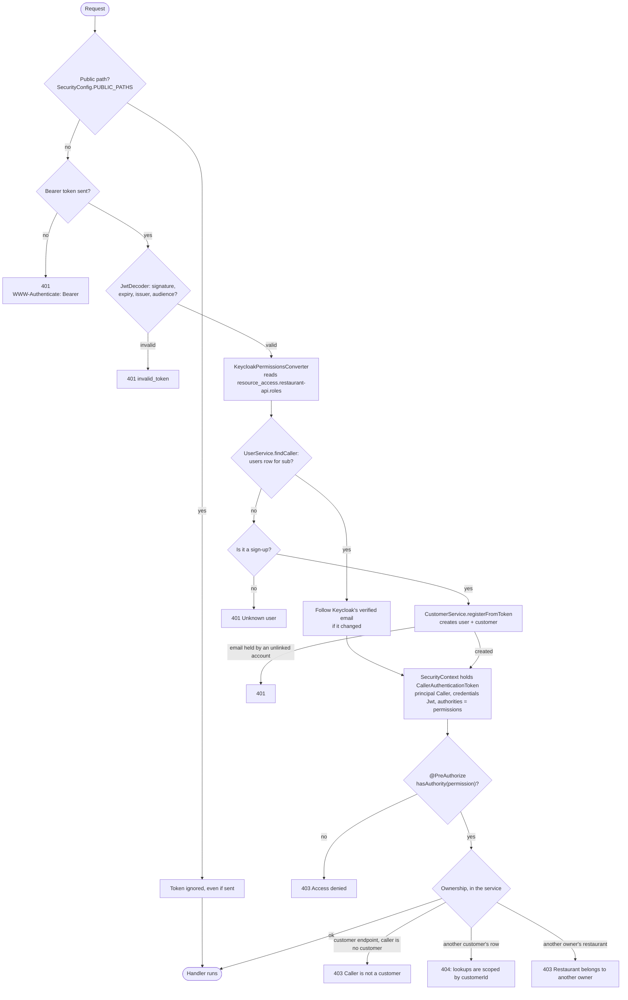
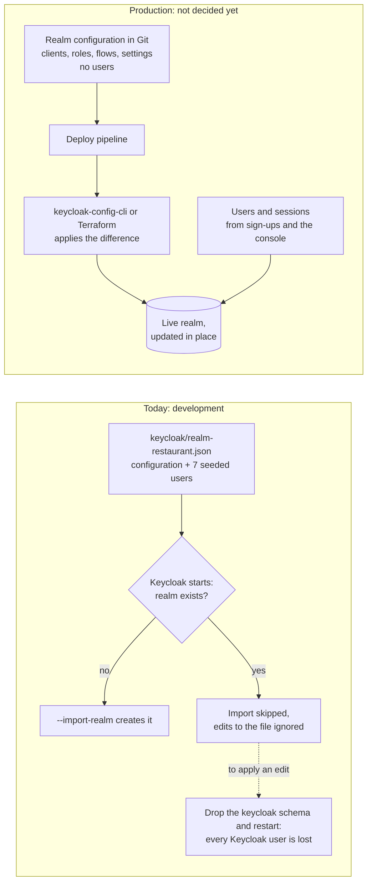

# Authentication and authorization

How a request is authenticated and authorized today, end to end. The reasons behind each choice are
in the ADRs ([links at the end](#further-reading)); this page describes how the pieces fit.

In one sentence: **Keycloak logs people in and issues a signed token; the API verifies it, maps
`sub` to our `users` row, and checks one permission per endpoint and ownership in the service.**

## 1. The pieces

- **Keycloak** owns logins, emails and roles. It is a local image (`docker/keycloak/Dockerfile`)
  that adds the email-code plugin, and keeps its tables in the `keycloak` schema under its own role
  (`docker/postgres/init/01-keycloak.sql`).
- **The API never calls Keycloak** except to fetch its public keys, the first time a token arrives.
  It holds no Keycloak credential.
- **The two sides are linked by one column**: `users.user_keycloak_id` = the token's `sub`.

## 2. Logging in and the first request

A token is a **sign-up** when all of these hold: `email_verified: true`, it carries
`customer.write`, it carries no kitchen permission (`order.accept`, `order.reject`,
`order.prepare`), and `azp` is in `app.security.sign-up-clients`. Restaurant owners and the admin
are never created this way; their `users` row is linked by hand.

## 3. What happens to one request

Three layers, each answering one question:

| Layer | Question | Where | Failure |
| --- | --- | --- | --- |
| Filter chain | Who are you? | `SecurityConfig`, `CallerAuthenticationConverter` | 401 |
| Method security | May you do this? | `@PreAuthorize` on each handler | 403 |
| Service | Is this row yours? | `caller.requireCustomerId()`, `RestaurantService.ensureOwnedBy` | 403 or 404 |

The converter runs **once per request that carries a valid token on a protected path**, never on
public paths or for a missing or invalid token. It costs one query every time: sessions are off
(`STATELESS`) and nothing is cached between requests.

### The objects involved

`CallerAuthenticationConverter` returns a `CallerAuthenticationToken` whose principal is a
`Caller(userId, customerId)` (`customerId` is null for owners and the admin), whose credentials are
the verified `Jwt`, and whose authorities are the permissions. Controllers receive the `Caller`
through `@AuthenticationPrincipal`; the Keycloak id is `authentication.getName()`. `CallerRow` is
only the shape of the lookup query.

## 4. Roles and permissions

Endpoints check **permissions, never roles**. Permissions are client roles of `restaurant-api`; the
three realm roles are composites of them, and Keycloak expands them into the token's
`resource_access.restaurant-api.roles`. `default-roles-restaurant` grants `CUSTOMER`, so every new
Keycloak user is a customer.

| Realm role | Permissions |
| --- | --- |
| `CUSTOMER` | `customer.read/write`, `address.read/write`, `payment-method.read/write`, `cart.read/write`, `order.create`, `order.read`, `order.cancel`, `order.rate` |
| `RESTAURANT_OWNER` | `order.read`, `order.accept`, `order.reject`, `order.prepare`, `restaurant.write`, `menu.write` |
| `ADMIN` | all of the above, plus `restaurant.create` and `restaurant.delete` |

`keycloak/realm-restaurant.json` is the source of these mappings.

### What keeps the realm and the code in step

- **`EndpointSecurityVerifier`** refuses to start the application if a handler of ours has neither
  `@PreAuthorize` nor `@PublicEndpoint`. The filter chain only demands a login, so a forgotten
  annotation would otherwise open the endpoint to every logged-in user.
- **`EndpointAuthorizationTest`** fails the build if an endpoint's permission is missing from the
  realm file or from the roles that should hold it.
- **`RealmPermissionsTest`** checks that test tokens (`jwts.tokenFor(id, "CUSTOMER")`) carry exactly
  what the realm file grants. Tests never talk to Keycloak: `TestJwtConfig` trusts a key pair made
  per run.

## 5. Realm configuration: development and production

**Today's setup is for development only.** Keycloak reads the realm file once, at startup, and only
when the realm does not exist yet; the Kubernetes operator's `KeycloakRealmImport` behaves the same
way. The two ways to push the file into a running Keycloak do not suit production either:

- **Partial import** (`kcadm.sh create partialImport -s ifResourceExists=OVERWRITE`) applies users,
  groups, clients and roles, but silently skips login flows and realm settings, and `OVERWRITE`
  recreates the users it lists.
- **Deleting the realm and restarting** re-imports everything, but loses every user who signed up.
  Their `users` rows survive, so a returning user gets a new `sub` and a 401.

**In production, configuration and data are managed apart**, as Flyway does for the schema and its
rows:

| | Configuration | Data |
| --- | --- | --- |
| What | clients, roles and their permissions, flows, SMTP, token lifetimes, security settings | users, credentials, sessions |
| Owner | Git, reviewed like code | Keycloak at runtime |
| Changed by | a tool that applies the difference on each deploy | sign-ups, the admin console |
| Deleted and re-created | never | never |

The two common tools:

- **keycloak-config-cli** (adorsys) reads the realm JSON format we already have and applies it
  through the Admin API, flows and settings included. It runs as a one-off container in the deploy
  pipeline. The smaller step from here.
- **The Terraform Keycloak provider** shows a plan before applying and detects changes made in the
  console, but means rewriting the realm file as Terraform resources.

Either way the seeded users move to a development-only file. **Recommendation: keycloak-config-cli,
not adopted yet.** It is a new dependency, so adopting it needs an ADR first, and it only matters
once a shared Keycloak holds users that cannot be lost.

**Deploying a permission change.** A permission lives in two places, the realm and
`@PreAuthorize`, deployed separately. Expand, then contract:

- **Adding one**: apply the realm change first, then deploy the code that requires it.
- **Removing or renaming one**: deploy the code that stops requiring it first, then remove it from
  the realm.

Tokens already issued keep their old permissions until they expire: the realm sets no access-token
lifespan, so that is Keycloak's default of 5 minutes.

## 6. Where the code is

The core is 9 files, 456 lines with comments and imports, about 244 without.

| File | Lines | Role |
| --- | ---: | --- |
| `config/SecurityConfig.java` | 65 | Filter chain, public paths, public paths ignore tokens |
| `config/CallerAuthenticationConverter.java` | 136 | Token to `Caller`, sign-up on first request |
| `config/KeycloakPermissionsConverter.java` | 34 | Token to permissions |
| `config/CallerAuthenticationToken.java` | 39 | What the `SecurityContext` holds |
| `user/model/Caller.java` | 18 | `userId`, `customerId`, `requireCustomerId()` |
| `user/model/CallerRow.java` | 14 | Result of the lookup query |
| `user/service/UserService.java` | 76 | `findCaller`, following Keycloak's email |
| `config/PublicEndpoint.java` | 15 | Marks a deliberately public handler |
| `config/EndpointSecurityVerifier.java` | 59 | Startup check that every handler is guarded |

Outside Java:

| File | Lines |
| --- | ---: |
| `keycloak/realm-restaurant.json` | 426 |
| `compose.yaml` (Keycloak, Mailpit) | about 50 |
| `docker/keycloak/Dockerfile` | 9 |
| `docker/postgres/init/01-keycloak.sql` | 13 |
| Migrations V15 to V17 | 24 |
| `application.properties` (issuer, keys, audience, sign-up clients, Swagger client) | 6 |

Tests: `support/TestJwtConfig` and `support/JwtTestSupport` (246 lines) sign test tokens; the auth
tests in `config/` and `support/RealmPermissionsTest` add about 640.

## Further reading

- [ADR 0007: Keycloak as identity provider](../decisions/0007-keycloak-as-identity-provider.md)
- [ADR 0008: Permissions as Keycloak client roles](../decisions/0008-permissions-as-keycloak-client-roles.md)
- [ADR 0009: Caller resolved after verification](../decisions/0009-caller-resolved-after-verification.md)
- [ADR 0010: Email-code login and Keycloak sign-up](../decisions/0010-email-code-login-and-keycloak-sign-up.md)
- [Auth roadmap](../designs/2026-10-14-auth-roadmap.md)
