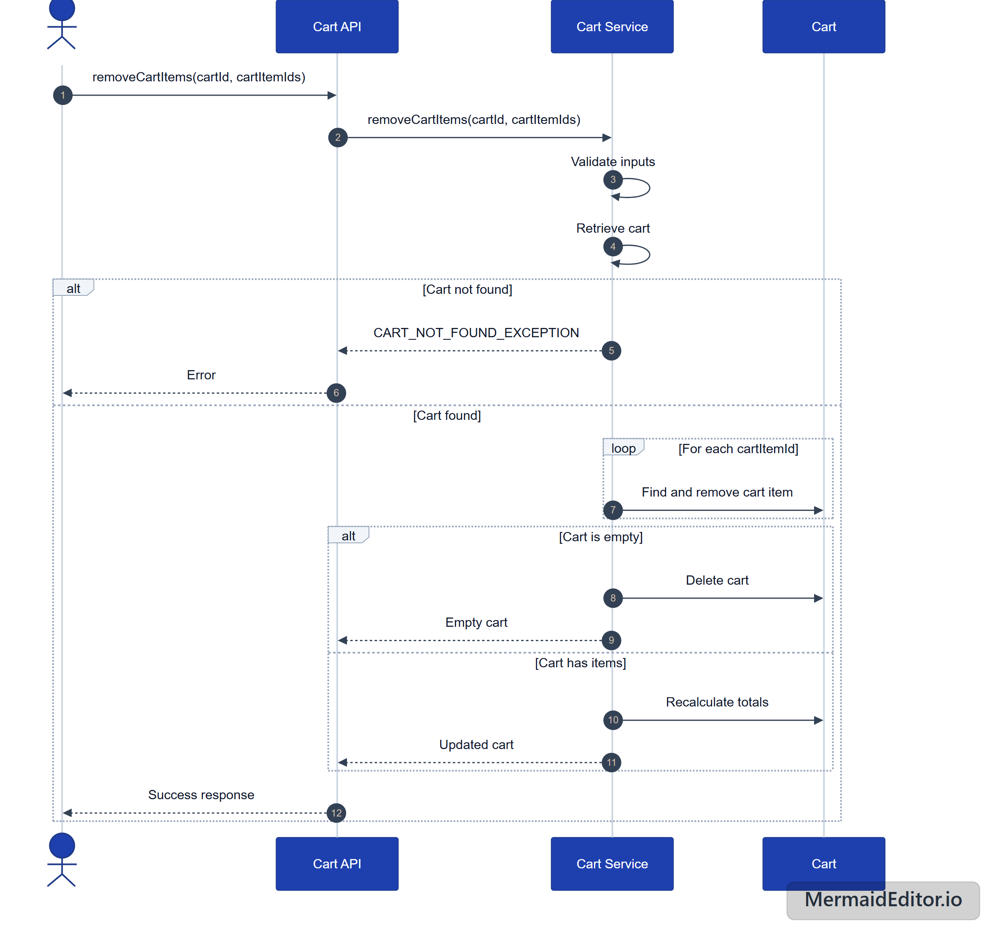
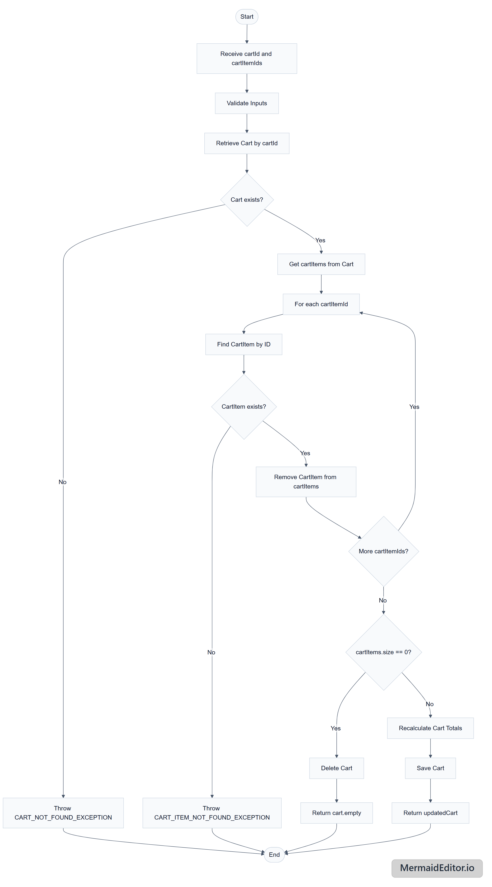

# Remove Items from Cart - Technical Documentation

**Access:** a bearer token with `cart.write` (#83 part 4).

## Overview
This document describes the functionality for removing items from a shopping cart in the Good Delivery application. The operation allows users to remove individual items or multiple items from their cart.

## Authorisation

`DELETE /api/v1/cart/{cartId}/items?cartItemIds=…`. A token and `cart.write` are required (#83 part 4). The customer is the caller, taken from the token
(#83 part 2, ADR 0009). The endpoint keeps `{cartId}`, which names a resource rather than the caller,
and every lookup is scoped to `cart.id` **and** the caller's customer: someone else's cart is 404
"Cart not found", the same as a missing one. A caller who is not a customer gets 403 "Caller is not a
customer". Before part 2 these endpoints checked no owner at all.

## Pseudo Code

```text
Transactional method
Cart Function removeCartItems(cartId, cartItemIds) {

  // Checked before the delete, so a missing cart is reported as a missing cart
  // rather than as missing items.
  if not cartExists(cartId) {
    throw CART_NOT_FOUND_EXCEPTION;
  }

  // The same id twice deletes one row, which would otherwise read as a missing item.
  requestedIds = deduplicate(cartItemIds);

  // Scoped by cart, so one cart cannot remove another's items. Checked before the
  // delete rather than inferred from its row count: the count says how many ids
  // missed but not which, and by then the matching rows are already gone.
  presentIds = findCartItemIds(cartId, requestedIds);
  if presentIds.size != requestedIds.size {
    throw CART_ITEM_NOT_FOUND_EXCEPTION(requestedIds - presentIds);
  }

  // One statement, not one delete per row.
  deleteCartItems(cartId, requestedIds);

  // Read after the delete. A cart loaded before it keeps a stale item collection,
  // and the bulk delete detaches it, so the response would describe rows that no
  // longer exist.
  cart = getCartById(cartId).orThrow(CART_NOT_FOUND_EXCEPTION);

  // Removing the last item empties the cart but does not delete it. A customer who
  // removes everything still has a cart, and a following GET expects to find one.
  return cart;
}
```

## Sequence Diagram


## Flow Diagram
