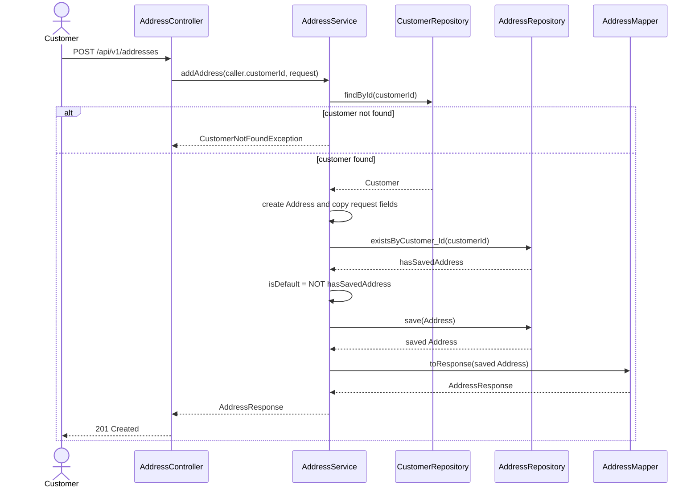
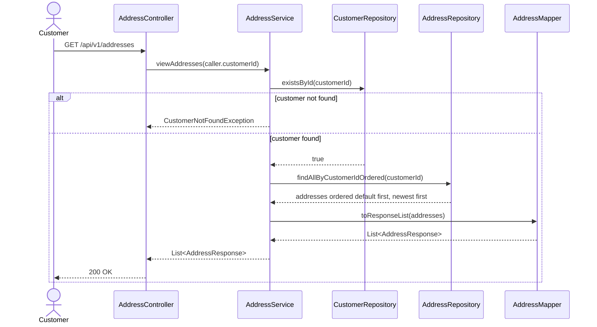
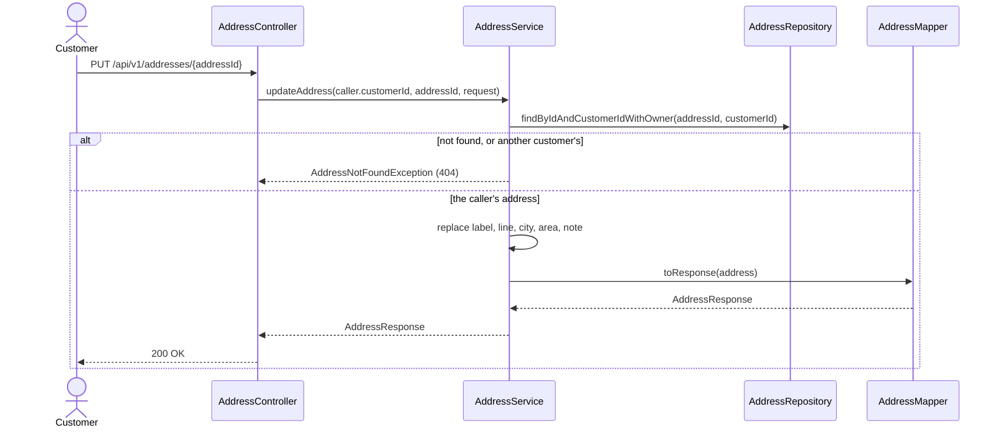
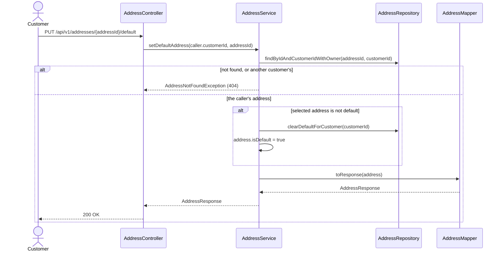
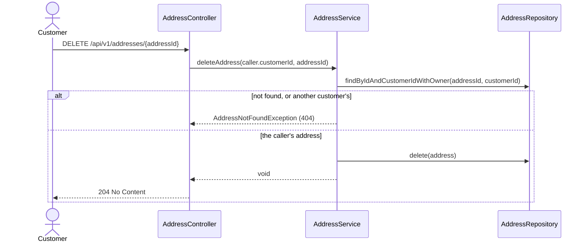

# Address Management Sequence Diagrams

Related documents: [Use case](./address-management.md) and [Pseudocode](./pseudocode.md).

The controller takes the customer from the token (`caller.customerId`, #83 part 2); a caller who is
not a customer is refused with 403 before the service runs. Soft-delete checks are left out here; the
use case lists them.

## Add Address

## View Addresses

## Update Address

## Set Default Address

## Delete Address

