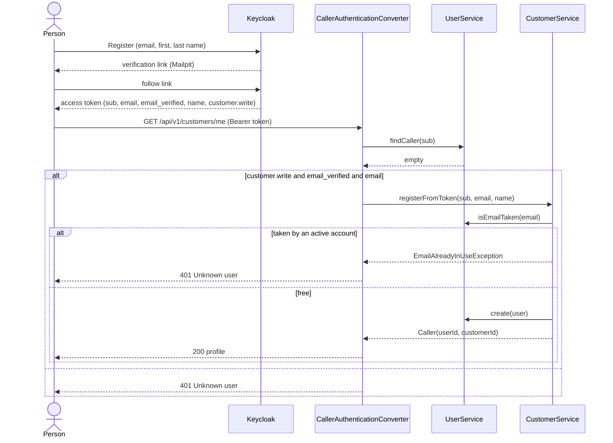

# Goal

**Access:** Keycloak's registration page, then any customer endpoint with the new token (#83 part 3).

A prospective customer creates their account on Keycloak's page; the API creates their user and
customer rows on their first request. ADR 0010 records why.

Issue [#120](https://github.com/msmohammed0077-cmd/mentorship-restaurant/issues/120), under
[#83](https://github.com/msmohammed0077-cmd/mentorship-restaurant/issues/83). It replaces
`POST /api/v1/customers` (#73), which stored a password and created no Keycloak user.

## Actor

A prospective customer, in a browser (Swagger UI → Authorize → *Register* in development).

## Preconditions

No Keycloak user has the email.

## Business Rules

1. **Keycloak asks for email, first name and last name.** There is no password anywhere.
2. **The email must be verified** before Keycloak issues a token: it sends a link (to Mailpit in
   development).
3. **Every new Keycloak user gets the `CUSTOMER` role** (`default-roles-restaurant`).
4. **The first request creates the rows**, in one transaction: a `users` row (name, email trimmed
   and lower-cased, `user_keycloak_id` = the token's `sub`) and its `customers` row. Phone, date of
   birth and gender start empty; `PATCH /customers/me` sets them.
5. Only a token holding **`customer.write`** with **`email_verified: true`** and an **`email`**
   creates rows. The name is the `name` claim, else the email, cut to 150 characters.
6. **An active account already holding the email is refused** (401), not linked: it was created
   by the old `POST /customers` and has no Keycloak user.
7. An email that belongs only to a **soft-deleted** account is reusable.
8. **No cart is created.** Carts are created lazily by add-cart-item.
9. Later requests find the rows by `sub` and create nothing.

## Main Success Scenario

1. The person opens Swagger UI's login and chooses *Register*.
2. They enter email, first and last name.
3. Keycloak emails a verification link; they follow it and are logged in.
4. Swagger UI calls `GET /api/v1/customers/me` with the token.
5. The API finds no `users` row for `sub`, checks the token, creates the user and customer, and
   answers 200 with the profile.

## Exception Flows

- **4a. The token lacks `customer.write`, `email`, or a `true` `email_verified`:** 401, no rows.
- **4b. An active account already has the email:** 401, that account unchanged.
- **4c. Two first requests at once:** the second insert hits `uq_users_keycloak_id`; it re-reads
  the first one's rows and both answer 200.

## Postconditions

One `users` row linked to the Keycloak user and one `customers` row; no cart, no address.

## Diagram

### Sequence Diagram



## Structure

```text
CallerAuthenticationConverter (config)
  -> UserService.findCaller               (user domain)
  -> CustomerService.registerFromToken    (customer domain; injects UserService one way)
```

## Testing

`FirstLoginEndpointTest`, over HTTP with signed tokens (no Keycloak): rows created on first request;
same rows on the next; name falls back to the email; a 151-character name is cut; no
`customer.write`, no email, unverified email, and an unlinked account holding the email are each
401 with no rows; a soft-deleted account's email is reusable. `CallerAuthenticationConverterTest`
covers the race.

The Keycloak side is checked by hand (the PR description lists the steps).

# Notes

The realm, flows and plugin settings are in `keycloak/realm-restaurant.json`; the design is
`.docs/designs/2026-10-16-email-otp-signup-design.md`.
