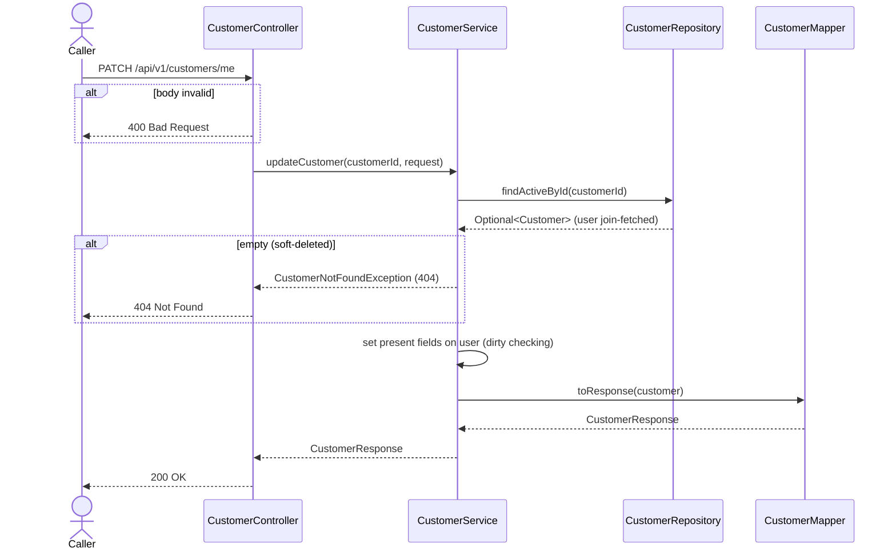

# Goal

**Access:** a bearer token with `customer.write` (#83 part 4).

Let a customer edit their profile. Login and the login email belong to Keycloak (#83 part 3).

Issue [#71](https://github.com/msmohammed0077-cmd/mentorship-restaurant/issues/71), under the
Customer Management umbrella [#68](https://github.com/msmohammed0077-cmd/mentorship-restaurant/issues/68).

## Actor

The customer, as the caller (see *Authorisation*).

## Preconditions

The customer exists and is not soft-deleted.

## Scope

`PATCH /api/v1/customers/me` — **200** with the updated profile.

Builds on #73 and #69 (`CustomerController`, `CustomerService`, `CustomerMapper`,
`CustomerRepository.findActiveById`). Adds `UpdateCustomerRequest` and
`CustomerService.updateCustomer`.

Until #83 part 3 a second endpoint, `PUT /api/v1/customers/me/password`, changed the password, and
the PATCH could change the email. Keycloak now owns both: login is an emailed code with no password,
and the login email is Keycloak's (ADR 0010).

## Business Rules

1. A **soft-deleted** customer is refused with 404, "Customer not found"
   (`findActiveById`).
2. Every field is **optional. Absent or `null` means unchanged.** Only the fields sent are written.
3. **Optional fields cannot be cleared** through this endpoint. Because `null` means "leave as is",
   there is no way to set `phone`, `date_of_birth` or `gender` back to `null`. Accepted limitation.
4. An `email` property is **ignored**, like any unknown property: Keycloak owns the login email
   (#83 part 3), and changing only our copy would split the two.
5. The customer is a **managed entity**: the service mutates `customer.getUser()` and dirty checking
   issues the `UPDATE`. No `save()`.

## Authorisation

A token and `customer.write` are required (#83 part 4). The customer is the caller (#83 part 2, ADR 0009):
the path is `/me`, the service takes the customer id from the token, and a caller who is not a
customer gets 403 "Caller is not a customer". Before part 2 the path carried the customer's id, and
this was an **IDOR**: anyone could edit the profile of any customer's account by id.

## API

```http
PATCH /api/v1/customers/me
Content-Type: application/json
```

```json
{
  "name": "Sara Hassan",
  "phone": "+201009876543"
}
```

| Field | Rule when present |
| --- | --- |
| `name` | not blank, max 150 |
| `phone` | `^\+?[0-9]{7,15}$` |
| `date_of_birth` | in the past |
| `gender` | `MALE` or `FEMALE` |

Response, **200**, the full profile:

```json
{
  "customer_id": 4,
  "name": "Sara Hassan",
  "email": "sara@example.com",
  "phone": "+201009876543",
  "date_of_birth": "1995-04-12",
  "gender": "FEMALE"
}
```

**Not blank when present.** `@NotBlank` would also reject `null`, which here means "unchanged", so
`name` uses `@Pattern(regexp = "(?s).*\\S.*")` instead: `null` passes, `""` and `"   "` do not.

## Main Success Scenario

1. The caller sends the fields to change.
2. The system validates the shape of the fields that are present.
3. The system loads the active customer and its user.
4. The system writes the present fields; dirty checking updates the row.
5. The system returns 200 with the profile.

## Exception Flows

- **2a. A present field is invalid** (blank name, bad phone, a date of birth not in the past, an
  unknown gender): 400.
- **3a. No active customer for the caller:** 404, "Customer not found".

## Postconditions

The sent fields are changed on the `users` row; everything else is as it was.

## Diagram

### Sequence Diagram



## Structure

```text
CustomerController -> CustomerService        (@Service, @Transactional)
                   -> CustomerRepository     (findActiveById)
                   -> CustomerMapper         (CustomerResponse)
```

## Testing

End-to-end, on customers the test inserts through `CustomerEndpointTestSupport.insertCustomer`.
Seeded customers 1–3 are never mutated.

`UpdateCustomerEndpointTest`:

| Case | Expected |
| --- | --- |
| PATCH `name` + `phone` | 200, both changed; email, date of birth and gender unchanged |
| PATCH `email` | 200, stored email unchanged |

Emails are created under the class's prefix (`update.customer.test.`), and cleanup deletes only
those users. The `customers` rows go with them by cascade.

# Notes

1. **Optional fields cannot be cleared.** See rule 3. Clearing would need explicit-null handling
   (e.g. JSON Merge Patch), which is not worth it yet.
2. **Profile edits stay in our database.** Keycloak's first and last name are not updated when the
   name changes here; copying profile edits back to Keycloak is out of scope for #83 part 3.
