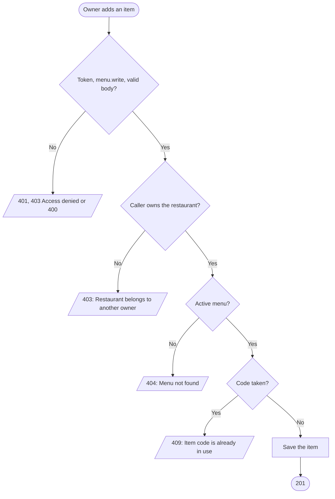
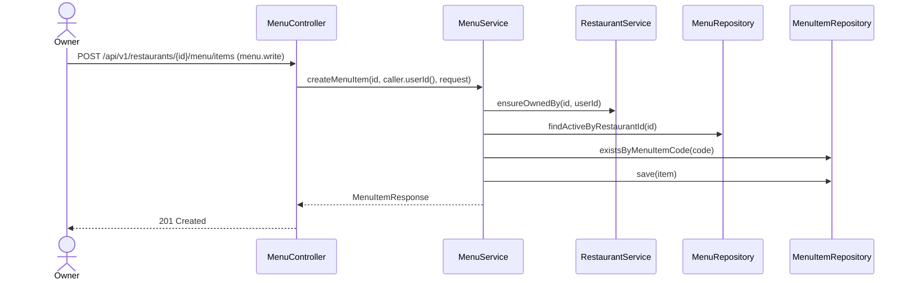

# Goal

A restaurant's owner adds an item to its menu.

Issue [#97](https://github.com/msmohammed0077-cmd/mentorship-restaurant/issues/97), under the
Menu CRUD umbrella [#92](https://github.com/msmohammed0077-cmd/mentorship-restaurant/issues/92).
Design: [menu CRUD](../../../designs/2026-10-17-menu-crud-design.md).

## Actor

Restaurant Owner (`menu.write`, held by `RESTAURANT_OWNER`).

## Preconditions

The restaurant belongs to the caller and has a menu that is not deleted.

## Scope

`POST /api/v1/restaurants/{restaurantId}/menu/items` — **201** with the new item.

Adds `CreateMenuItemRequest`, `MenuService.createMenuItem` and `MenuItemCodeInUseException` (409).
`MenuItem` gains a builder (ADR 0005).

## Business Rules

1. Only the restaurant's **owner**, checked before anything is read; the admin is refused too.
2. The item goes on the restaurant's **one menu**; a restaurant with none is 404, "Menu not found".
   The request names no menu.
3. The **code** must not be used by any item, deleted or not, as V1's `UNIQUE` constraint on
   `menu_item_code` demands: 409, "Item code is already in use".
4. **Available unless told otherwise**: an absent `is_available` means `true`.
5. `image_url` is a plain optional URL; uploading images is #101.

## Authorisation

As [create-menu](../create-menu/create-menu.md#authorisation): a token, `menu.write`, and ownership.

## API

```http
POST /api/v1/restaurants/4/menu/items
Authorization: Bearer <owner token>
Content-Type: application/json

{
  "code": "KC-KOSHARY-01",
  "name": "Koshary Bowl",
  "price": 85.50,
  "stock": 20,
  "note": "With crispy onions.",
  "image_url": "https://example.com/koshary.jpg"
}
```

| Field | Rule |
| --- | --- |
| `code` | required, not blank, max 100 |
| `name` | required, not blank, max 150 |
| `price` | required, ≥ 0, at most 10 integer and 2 fraction digits (`NUMERIC(12, 2)`) |
| `stock` | required, ≥ 0 |
| `note` | optional, max 255 |
| `image_url` | optional, max 2048 |
| `is_available` | optional, default `true` |

Response, **201**: the item, as [get-menu](../get-menu/get-menu.md#api) lists it.

## Data Model

Inserts one `menu_items` row on the menu, `menu_item_is_available` as given (V18's column).

## Main Success Scenario

1. The owner sends the item.
2. The system checks the token, the permission and the body.
3. The system checks the caller owns the restaurant.
4. The system loads the restaurant's active menu.
5. The system checks the code is free.
6. The system saves the item and returns 201.

## Exception Flows

- **2a. No valid token:** 401. **2b. No `menu.write`:** 403, "Access denied". **2c. Body invalid:**
  400, naming each failing field.
- **3a. Not the owner, or no such restaurant:** 403, "Restaurant belongs to another owner".
- **4a. No active menu:** 404, "Menu not found".
- **5a. Code taken:** 409, "Item code is already in use".

## Postconditions

The item is on the menu; customers can add it to a cart if it is available and in stock.

## Diagram

### Flowchart



### Sequence Diagram



## Testing

`CreateMenuItemEndpointTest`, end-to-end, as the restaurant's owner unless stated; `MenuRaceTest`
for the race.

| Case | Expected |
| --- | --- |
| Every field | 201, available, category `Main`; stored |
| `is_available: false`, no note | 201, unavailable, no `note` |
| No menu | 404 "Menu not found" |
| A seeded item's code | 409 "Item code is already in use" |
| No token | 401, nothing stored |
| `CUSTOMER` token | 403 "Access denied" |
| Another restaurant's owner / the admin | 403 "Restaurant belongs to another owner", nothing stored |
| No name, no code, negative price, price with 3 decimals, negative stock, no stock | 400 naming the field |

# Notes

1. **Two simultaneous creates with the same code**: the second trips `menu_items_menu_item_code_key`,
   which the service answers with the same 409. `MenuRaceTest` covers it.
