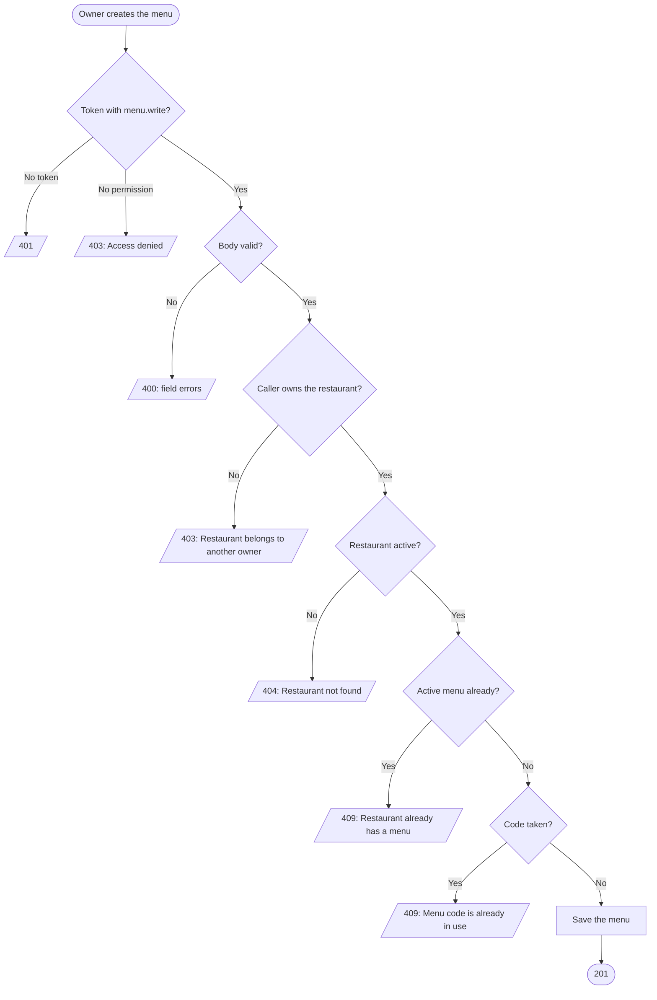
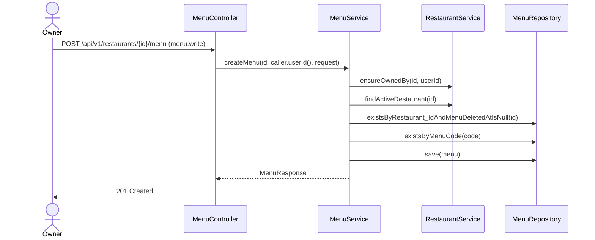

# Goal

A restaurant's owner creates its menu.

Issue [#93](https://github.com/msmohammed0077-cmd/mentorship-restaurant/issues/93), under the
Menu CRUD umbrella [#92](https://github.com/msmohammed0077-cmd/mentorship-restaurant/issues/92).
Design: [menu CRUD](../../../designs/2026-10-17-menu-crud-design.md).

## Actor

Restaurant Owner (`menu.write`, held by `RESTAURANT_OWNER`).

## Preconditions

The restaurant exists, is not deleted, belongs to the caller, and has no menu that is not deleted.

## Scope

`POST /api/v1/restaurants/{restaurantId}/menu` — **201** with the new menu, no items.

Adds `CreateMenuRequest`, `MenuService.createMenu`, `MenuRepository`, `MenuAlreadyExistsException`
and `MenuCodeInUseException` (both 409). `Menu` gains a builder (ADR 0005).

## Business Rules

1. Only the restaurant's **owner** may create its menu: `ensureOwnedBy(restaurantId,
   caller.userId())` runs **before anything is read**; anyone else, and an unknown restaurant, is
   403 "Restaurant belongs to another owner". `ADMIN` holds `menu.write` but owns no restaurant, so
   it is refused too.
2. **One menu per restaurant** (#93): a restaurant whose menu is not deleted gets 409, "Restaurant
   already has a menu". After a delete it may create a new one. The partial unique index
   `uq_menus_active_restaurant` is the backstop.
3. The **code** must not be used by any menu, **deleted or not**, as V1's `UNIQUE` constraint on
   `menu_code` demands: 409, "Menu code is already in use".
4. The owner's own **deleted restaurant** is 404, "Restaurant not found".

## Authorisation

A token and `menu.write` are required (ADR 0008), and the caller must own the restaurant (ADR 0009).
An id that does not exist is answered as another owner's is (403), so a caller cannot probe ids.

## API

```http
POST /api/v1/restaurants/4/menu
Authorization: Bearer <owner token>
Content-Type: application/json

{ "code": "KC-MAIN", "category": "Main" }
```

| Field | Rule |
| --- | --- |
| `code` | required, not blank, max 100 |
| `category` | required, not blank, max 100 |

Response, **201**:

```json
{ "menu_id": 5, "restaurant_id": 4, "code": "KC-MAIN", "category": "Main", "items": [] }
```

## Data Model

Inserts one `menus` row (`restaurant_id`, `menu_code`, `menu_category`; `menu_deleted_at` null).
V18 adds the partial unique index `uq_menus_active_restaurant` on `(restaurant_id) WHERE
menu_deleted_at IS NULL`.

## Main Success Scenario

1. The owner sends the menu's code and category.
2. The system checks the token and the permission.
3. The system validates the body (400 before the service runs).
4. The system checks the caller owns the restaurant.
5. The system loads the active restaurant.
6. The system checks the restaurant has no active menu and the code is free.
7. The system saves the menu and returns 201.

## Exception Flows

- **2a. No valid token:** 401.
- **2b. No `menu.write`:** 403, "Access denied".
- **3a. Body invalid:** 400, naming each failing field.
- **4a. Not the owner, or no such restaurant:** 403, "Restaurant belongs to another owner".
- **5a. The owner's restaurant is deleted:** 404, "Restaurant not found".
- **6a. A menu already exists:** 409, "Restaurant already has a menu".
- **6b. Code taken:** 409, "Menu code is already in use".

## Postconditions

The restaurant has one menu, with no items; `GET …/menu` returns it.

## Diagram

### Flowchart



### Sequence Diagram



## Testing

`CreateMenuEndpointTest`, end-to-end, as the restaurant's owner unless stated; `MenuRaceTest` for
the races.

| Case | Expected |
| --- | --- |
| Code and category | 201, no items; one active menu stored |
| No token | 401, nothing stored |
| `CUSTOMER` token | 403 "Access denied" |
| Another restaurant's owner / the admin / an unknown restaurant | 403 "Restaurant belongs to another owner", nothing stored |
| The owner's deleted restaurant | 404 "Restaurant not found" |
| A menu already exists | 409 "Restaurant already has a menu" |
| The old menu is deleted | 201 |
| A seeded menu's code / a deleted menu's code | 409 "Menu code is already in use" |
| Blank code, code of 101, no category | 400 naming the field |

# Notes

1. **Two simultaneous creates** both pass the checks; the second trips `uq_menus_active_restaurant`
   or `menus_menu_code_key`, which the service answers with the same 409s. `MenuRaceTest` covers
   both, as a unit test.
2. **A deleted menu's code stays taken.** Freeing it means replacing V1's constraint with a partial
   index; left out until someone needs it.
