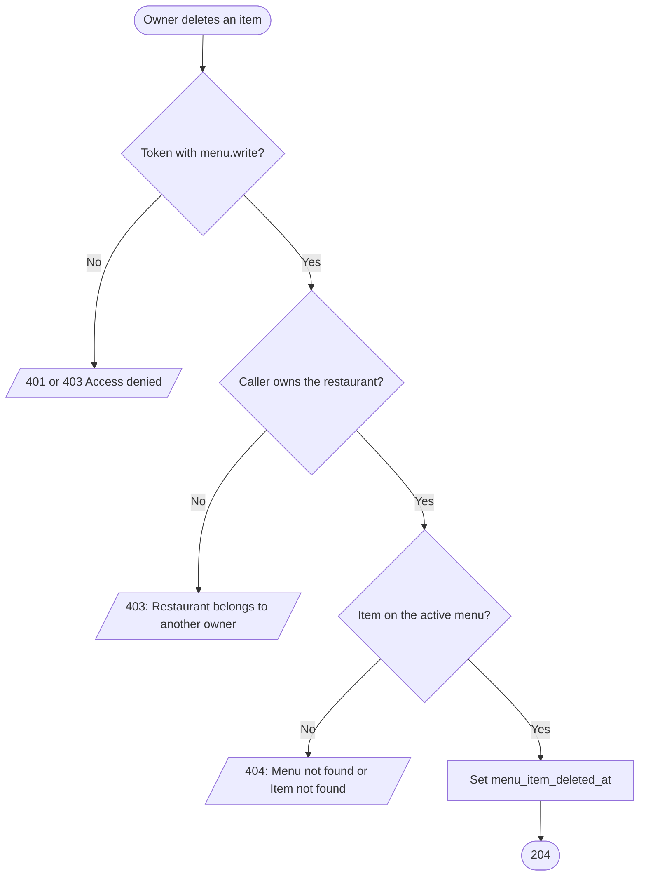
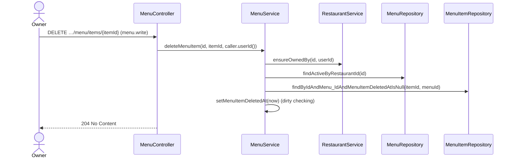

# Goal

A restaurant's owner removes an item from its menu.

Issue [#99](https://github.com/msmohammed0077-cmd/mentorship-restaurant/issues/99), under the
Menu CRUD umbrella [#92](https://github.com/msmohammed0077-cmd/mentorship-restaurant/issues/92).
Design: [menu CRUD](../../../designs/2026-10-17-menu-crud-design.md).

## Actor

Restaurant Owner (`menu.write`, held by `RESTAURANT_OWNER`).

## Preconditions

The restaurant belongs to the caller, its menu is not deleted, and the item is on that menu and not
deleted.

## Scope

`DELETE /api/v1/restaurants/{restaurantId}/menu/items/{menuItemId}` — **204**, no body.

Adds `MenuService.deleteMenuItem`. `RestaurantService.findMenuItem` and `ensureOrderableItems` no
longer find a deleted item or an item of a deleted menu.

## Business Rules

1. Only the restaurant's **owner**, checked before anything is read; the admin is refused too. The
   item must be on that restaurant's menu, as [update-menu-item](../update-menu-item/update-menu-item.md).
2. A **soft delete**: `menu_item_deleted_at` is set. Nothing is removed: `order_items` and
   `cart_items` reference the item without a cascade, and past orders keep their lines.
3. **Afterwards the item does not exist to the API:**
   - the menu read leaves it out; edit, availability and delete answer 404, "Item not found";
   - add-to-cart and modify-cart answer 404, "Item not found";
   - checkout and create-order of a cart holding it answer 404, "Item not found"; the cart is kept,
     and the customer removes the line.
4. Its **code stays taken**: V1's unique constraint covers deleted rows.

## Authorisation

As [create-menu](../create-menu/create-menu.md#authorisation): a token, `menu.write`, and ownership.

## API

```http
DELETE /api/v1/restaurants/4/menu/items/12
Authorization: Bearer <owner token>
```

Response, **204**, no body.

## Data Model

Writes `menu_items.menu_item_deleted_at`, a column V18 adds.

## Main Success Scenario

1. The owner asks to delete the item.
2. The system checks the token and the permission.
3. The system checks the caller owns the restaurant.
4. The system loads the restaurant's active menu, then the item on it.
5. The system marks the item deleted and returns 204.

## Exception Flows

- **2a. No valid token:** 401. **2b. No `menu.write`:** 403, "Access denied".
- **3a. Not the owner, or no such restaurant:** 403, "Restaurant belongs to another owner".
- **4a. No active menu:** 404, "Menu not found". **4b. Item not on it, or already deleted:** 404,
  "Item not found". Deleting twice is 404 the second time.

## Postconditions

The item is gone from the menu and cannot be carted or ordered; past orders still show it.

## Diagram

### Flowchart



### Sequence Diagram



## Testing

`DeleteMenuItemEndpointTest`, end-to-end, as the restaurant's owner unless stated. The paths
afterwards: `AddCartItemEndpointTest`, `ModifyCartItemEndpointTest`, `CheckoutCartEndpointTest` and
`CreateOrderEndpointTest`.

| Case | Expected |
| --- | --- |
| Delete an item | 204; soft-deleted; the menu lists no items; a second delete is 404 |
| A seeded restaurant's item | 404, not deleted |
| No token | 401, not deleted |
| `CUSTOMER` token | 403 "Access denied" |
| Another restaurant's owner / the admin | 403 "Restaurant belongs to another owner", not deleted |
| Add a deleted item to a cart / modify its line | 404 "Item not found"; nothing changes |
| Checkout, or create-order, of a cart holding it | 404 "Item not found"; cart kept, stock unchanged, no order |
