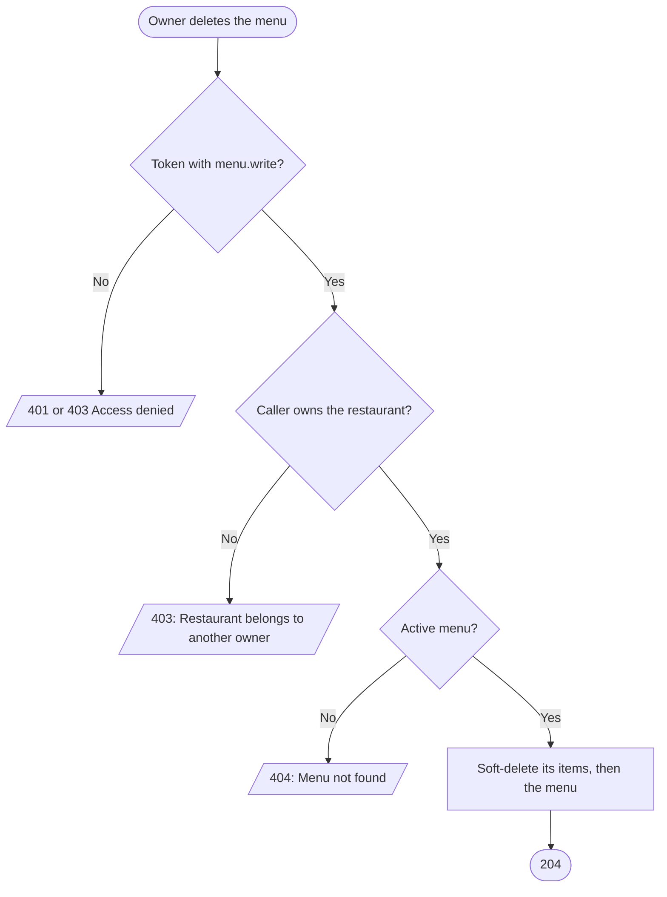
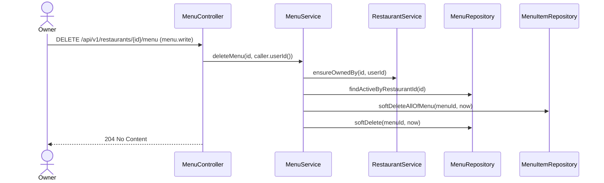

# Goal

A restaurant's owner removes its menu, and every item on it.

Issue [#95](https://github.com/msmohammed0077-cmd/mentorship-restaurant/issues/95), under the
Menu CRUD umbrella [#92](https://github.com/msmohammed0077-cmd/mentorship-restaurant/issues/92).
Design: [menu CRUD](../../../designs/2026-10-17-menu-crud-design.md).

## Actor

Restaurant Owner (`menu.write`, held by `RESTAURANT_OWNER`).

## Preconditions

The restaurant belongs to the caller and has a menu that is not deleted.

## Scope

`DELETE /api/v1/restaurants/{restaurantId}/menu` — **204**, no body.

Adds `MenuService.deleteMenu`, `MenuRepository.softDelete` and
`MenuItemRepository.softDeleteAllOfMenu`.

## Business Rules

1. Only the restaurant's **owner**, checked before anything is read; the admin is refused too.
2. A **soft delete**: the menu and each of its items not yet deleted get a deletion time, in **one
   statement each**, scoped to that menu. Nothing is removed: `order_items` and `cart_items`
   reference the items without a cascade, and past orders keep their lines.
3. **Afterwards the menu does not exist:** the read, edit, delete and every item endpoint answer
   404, "Menu not found"; its items cannot be added to a cart (404, "Item not found"), and a cart
   holding them cannot be checked out or ordered (404, "Item not found").
4. The restaurant may **create a new menu**, with a new code (a deleted menu's code stays taken).

## Authorisation

As [create-menu](../create-menu/create-menu.md#authorisation): a token, `menu.write`, and ownership.

## API

```http
DELETE /api/v1/restaurants/4/menu
Authorization: Bearer <owner token>
```

Response, **204**, no body.

## Data Model

Writes `menus.menu_deleted_at` and `menu_items.menu_item_deleted_at`, columns V18 adds.

## Main Success Scenario

1. The owner asks to delete the menu.
2. The system checks the token and the permission.
3. The system checks the caller owns the restaurant.
4. The system loads the restaurant's active menu, keeping only its id.
5. The system soft-deletes the menu's items, then the menu, and returns 204.

## Exception Flows

- **2a. No valid token:** 401. **2b. No `menu.write`:** 403, "Access denied".
- **3a. Not the owner, or no such restaurant:** 403, "Restaurant belongs to another owner".
- **4a. No menu, or already deleted:** 404, "Menu not found". Deleting twice is 404 the second time.

## Postconditions

The restaurant has no menu; its old items are kept for past orders but gone from the API.

## Diagram

### Flowchart



### Sequence Diagram



## Testing

`DeleteMenuEndpointTest`, end-to-end, as the restaurant's owner unless stated; the cart and order
tests for the paths afterwards (see [delete-menu-item](../delete-menu-item/delete-menu-item.md)).

| Case | Expected |
| --- | --- |
| A menu with an item | 204; menu and item soft-deleted; a second delete is 404 |
| No menu | 404 |
| No token | 401, not deleted |
| `CUSTOMER` token | 403 "Access denied", not deleted |
| Another restaurant's owner / the admin | 403 "Restaurant belongs to another owner", not deleted |

# Notes

1. **Bulk statements and the loaded menu.** Only the menu's id is taken from the entity before the
   two `@Modifying` updates, so nothing stale is read after them (`CLAUDE.md`, persistence rules).
