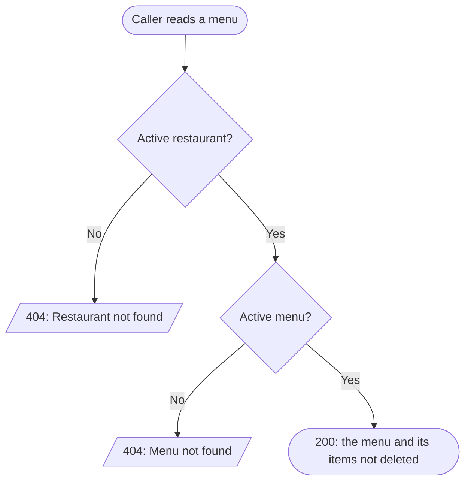
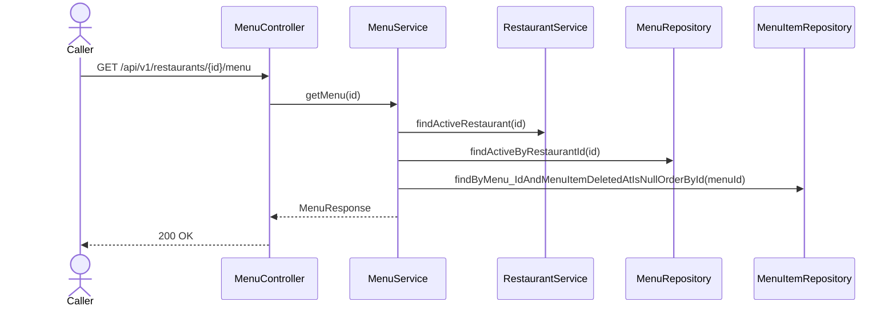

# Goal

Anyone reads a restaurant's menu: its code, category and every item still on it.

Issue [#96](https://github.com/msmohammed0077-cmd/mentorship-restaurant/issues/96), under the
Menu CRUD umbrella [#92](https://github.com/msmohammed0077-cmd/mentorship-restaurant/issues/92).
Design: [menu CRUD](../../../designs/2026-10-17-menu-crud-design.md).

## Actor

Any caller, with or without a token.

## Preconditions

The restaurant exists, is not deleted, and has a menu that is not deleted.

## Scope

`GET /api/v1/restaurants/{restaurantId}/menu` — **200** with the menu and its items.

Adds `MenuController`, `MenuService.getMenu`, `MenuMapper`, `MenuResponse` and `MenuItemResponse`.

## Business Rules

1. **Every item that is not deleted** is listed, **available or not**; `is_available` says which. A
   client hides or greys out the unavailable ones; the owner sees what they took off.
2. Items are in **id order**.
3. Each item carries the **menu's category** (#96 asks for a category per item; a restaurant's one
   menu holds it).
4. A **deleted restaurant** is 404 "Restaurant not found", as `GET /restaurants/{id}` answers. A
   restaurant **with no menu**, or whose menu is deleted, is 404 "Menu not found".
5. A read does not validate business state: an item out of stock or unavailable is still listed.

## Authorisation

None: a menu is public directory information, like the restaurant itself. The endpoint carries
`@PublicEndpoint` and is in `SecurityConfig.PUBLIC_PATHS` (`GET` only), which also ignores any token
sent to it.

## API

```http
GET /api/v1/restaurants/1/menu
```

Response, **200**:

```json
{
  "menu_id": 1,
  "restaurant_id": 1,
  "code": "NK-MAIN",
  "category": "Main",
  "items": [
    {
      "menu_item_id": 1,
      "code": "NK-KOFTA-01",
      "name": "Kofta Platter",
      "category": "Main",
      "price": 185.00,
      "stock": 50,
      "note": "Freshly prepared Egyptian kofta with rice and salad.",
      "image_url": "https://example.com/images/kofta-platter.jpg",
      "is_available": true
    }
  ]
}
```

A null `note` or `image_url` is left out (global Jackson setting).

## Data Model

No migration of its own; reads `menus` and `menu_items` with the soft-delete columns V18 adds.

## Main Success Scenario

1. The caller asks for a restaurant's menu.
2. The system loads the active restaurant.
3. The system loads its active menu and the menu's items that are not deleted.
4. The system returns 200 with the menu.

## Exception Flows

- **2a. Restaurant unknown or deleted:** 404, "Restaurant not found".
- **3a. No menu, or the menu is deleted:** 404, "Menu not found".

## Postconditions

Nothing changes.

## Diagram

### Flowchart



### Sequence Diagram



## Testing

`GetMenuEndpointTest`, end-to-end, with no token.

| Case | Expected |
| --- | --- |
| A menu with an available, an unavailable and a deleted item | 200, two items in id order, `is_available` true then false |
| Seeded restaurant 1 | 200, `NK-MAIN`, first item `NK-KOFTA-01` |
| An invalid token | 200, ignored |
| No menu / a deleted menu | 404 "Menu not found" |
| Unknown / deleted restaurant | 404 "Restaurant not found" |
