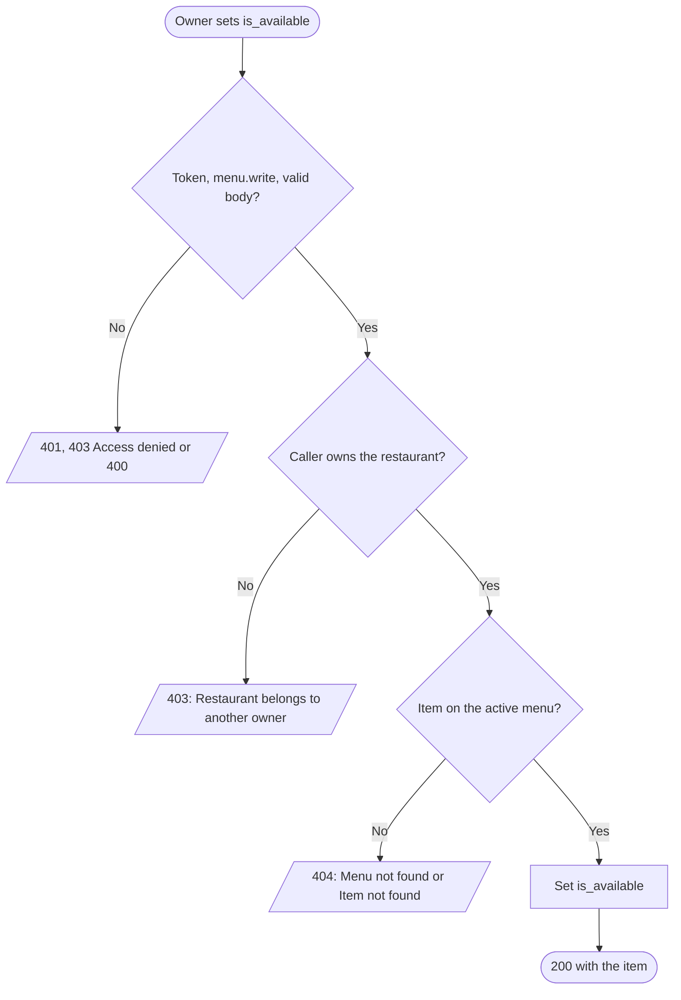
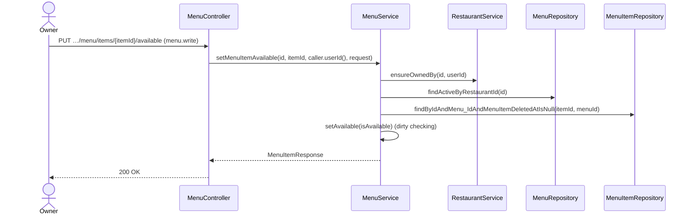

# Goal

A restaurant's owner takes an item off, or puts it back, without changing its stock.

Issue [#100](https://github.com/msmohammed0077-cmd/mentorship-restaurant/issues/100), under the
Menu CRUD umbrella [#92](https://github.com/msmohammed0077-cmd/mentorship-restaurant/issues/92).
Design: [menu CRUD](../../../designs/2026-10-17-menu-crud-design.md).

## Actor

Restaurant Owner (`menu.write`, held by `RESTAURANT_OWNER`).

## Preconditions

The restaurant belongs to the caller, its menu is not deleted, and the item is on that menu and not
deleted.

## Scope

`PUT /api/v1/restaurants/{restaurantId}/menu/items/{menuItemId}/available` — **200** with the item.

Adds `SetMenuItemAvailableRequest`, `MenuService.setMenuItemAvailable`,
`MenuItemUnavailableException` (409), `RestaurantService.ensureOrderableItems`, and the availability
guards in add-to-cart, modify-cart, checkout and create-order.

## Business Rules

1. Only the restaurant's **owner**, checked before anything is read; the admin is refused too. The
   item must be on that restaurant's menu, as [update-menu-item](../update-menu-item/update-menu-item.md).
2. `is_available` is **required**. **Idempotent**: setting the current value again is 200.
3. **Availability is its own flag**, beside stock: an item can be in stock and unavailable (the
   kitchen ran out of an ingredient), and the owner does not lose its stock count.
4. **An unavailable item stays on the menu** with `is_available: false`, but cannot be bought:
   - add-to-cart and modify-cart refuse it: 409, "Item is unavailable";
   - checkout and create-order refuse a cart holding it: 409, "Item is unavailable"; the cart is
     kept;
   - the cart's read does not validate it, as it does not validate a closed restaurant.
5. Putting it back makes it buyable again; carts are not touched either way.

## Authorisation

As [create-menu](../create-menu/create-menu.md#authorisation): a token, `menu.write`, and ownership.

## API

```http
PUT /api/v1/restaurants/4/menu/items/12/available
Authorization: Bearer <owner token>
Content-Type: application/json

{ "is_available": false }
```

| Field | Rule |
| --- | --- |
| `is_available` | required, boolean |

Response, **200**: the item.

## Data Model

Writes `menu_items.menu_item_is_available`, a column V18 adds (`NOT NULL DEFAULT TRUE`, so every
existing item starts available).

## Main Success Scenario

1. The owner sends `is_available`.
2. The system checks the token, the permission and the body.
3. The system checks the caller owns the restaurant.
4. The system loads the restaurant's active menu, then the item on it.
5. The system sets the flag and returns 200 with the item.

## Exception Flows

- **2a. No valid token:** 401. **2b. No `menu.write`:** 403, "Access denied". **2c. `is_available`
  missing:** 400.
- **3a. Not the owner, or no such restaurant:** 403, "Restaurant belongs to another owner".
- **4a. No active menu:** 404, "Menu not found". **4b. Item not on it, or deleted:** 404, "Item not
  found".

## Postconditions

The item is available or not as asked; carts and orders follow rule 4.

## Diagram

### Flowchart



### Sequence Diagram



## Testing

`SetMenuItemAvailableEndpointTest`, end-to-end, as the restaurant's owner unless stated. The guards:
`AddCartItemEndpointTest`, `ModifyCartItemEndpointTest`, `CheckoutCartEndpointTest` and
`CreateOrderEndpointTest`.

| Case | Expected |
| --- | --- |
| Take an item off / put it back | 200; stored |
| Set the current value again | 200 |
| `{}` | 400 naming `isAvailable` |
| A seeded restaurant's item | 404 "Item not found", unchanged |
| A deleted item | 404 |
| No token | 401, unchanged |
| `CUSTOMER` token | 403 "Access denied" |
| Another restaurant's owner / the admin | 403 "Restaurant belongs to another owner", unchanged |
| Add an unavailable item to a cart / modify its line | 409 "Item is unavailable"; nothing changes |
| Checkout, or create-order, of a cart holding it | 409 "Item is unavailable"; cart kept, stock unchanged, no order |

# Notes

1. **A `PUT` of the flag, not on/off actions**, so a retried request is harmless, as
   set-restaurant-open.
