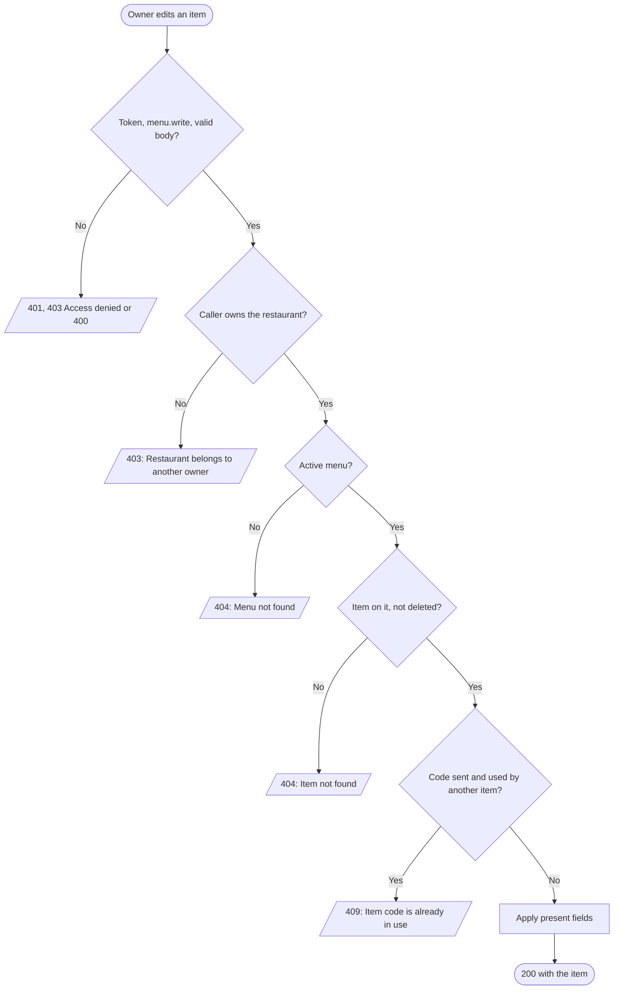
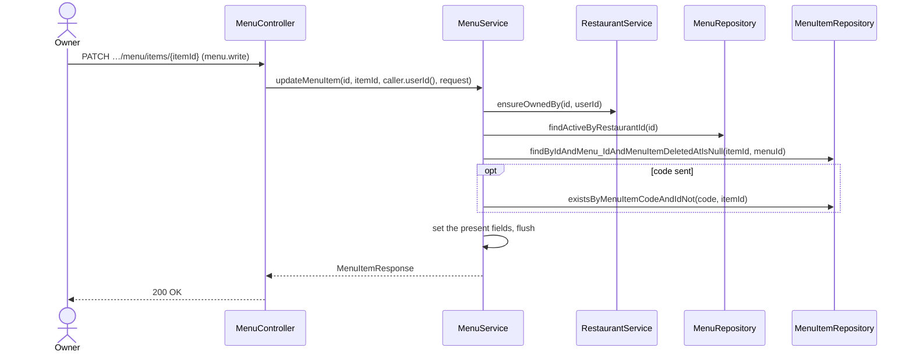

# Goal

A restaurant's owner changes one of its menu's items.

Issue [#98](https://github.com/msmohammed0077-cmd/mentorship-restaurant/issues/98), under the
Menu CRUD umbrella [#92](https://github.com/msmohammed0077-cmd/mentorship-restaurant/issues/92).
Design: [menu CRUD](../../../designs/2026-10-17-menu-crud-design.md).

## Actor

Restaurant Owner (`menu.write`, held by `RESTAURANT_OWNER`).

## Preconditions

The restaurant belongs to the caller, its menu is not deleted, and the item is on that menu and not
deleted.

## Scope

`PATCH /api/v1/restaurants/{restaurantId}/menu/items/{menuItemId}` — **200** with the item.

Adds `UpdateMenuItemRequest` and `MenuService.updateMenuItem`.

## Business Rules

1. Only the restaurant's **owner**, checked before anything is read; the admin is refused too.
2. The item must be **on that restaurant's menu**: another restaurant's item, a deleted item or an
   unknown id is 404, "Item not found". The restaurant with no active menu is 404, "Menu not found".
3. Every field is **optional**; absent or null leaves it as it is, so the note and image cannot be
   cleared here.
4. The **code** must not be used by **another** item, deleted or not: 409, "Item code is already in
   use". Re-sending the item's own code is accepted.
5. **Availability is not edited here**; it has its own endpoint,
   [set-menu-item-available](../set-menu-item-available/set-menu-item-available.md). An
   `is_available` in this body is ignored.
6. **A price change does not reach carts**: a cart line keeps the price it was added at
   (`cart_item_price`) until modify-cart rewrites it.
7. Changes are made on the loaded item and flushed within the use-case, so a racing code is a 409.

## Authorisation

As [create-menu](../create-menu/create-menu.md#authorisation): a token, `menu.write`, and ownership.

## API

```http
PATCH /api/v1/restaurants/4/menu/items/12
Authorization: Bearer <owner token>
Content-Type: application/json

{ "price": 90.25, "stock": 7 }
```

Fields as [create-menu-item](../create-menu-item/create-menu-item.md#api), all optional, without
`is_available`. Response, **200**: the item.

## Data Model

No migration. Writes the `menu_items` columns of the fields sent.

## Main Success Scenario

1. The owner sends the fields to change.
2. The system checks the token, the permission and the body.
3. The system checks the caller owns the restaurant.
4. The system loads the restaurant's active menu, then the item on it.
5. If a code is sent, the system checks no other item uses it.
6. The system applies the fields and returns 200 with the item.

## Exception Flows

- **2a. No valid token:** 401. **2b. No `menu.write`:** 403, "Access denied". **2c. Body invalid:**
  400.
- **3a. Not the owner, or no such restaurant:** 403, "Restaurant belongs to another owner".
- **4a. No active menu:** 404, "Menu not found". **4b. Item not on it, or deleted:** 404, "Item not
  found".
- **5a. Code used by another item:** 409, "Item code is already in use". Nothing changes.

## Postconditions

The item holds the new values; the menu read and new cart lines see them.

## Diagram

### Flowchart



### Sequence Diagram



## Testing

`UpdateMenuItemEndpointTest`, end-to-end, as the restaurant's owner unless stated.

| Case | Expected |
| --- | --- |
| Every field | 200; stored |
| `{"name": null}` | 200, unchanged |
| `is_available: false` | 200, still available |
| Its own code | 200 |
| A seeded item's code | 409, code unchanged |
| A seeded restaurant's item | 404 "Item not found" |
| A deleted item | 404 |
| An item of a deleted menu | 404 "Menu not found" |
| No token | 401 |
| `CUSTOMER` token | 403 "Access denied" |
| Another restaurant's owner / the admin | 403 "Restaurant belongs to another owner", unchanged |
| Negative price, blank name | 400 |
