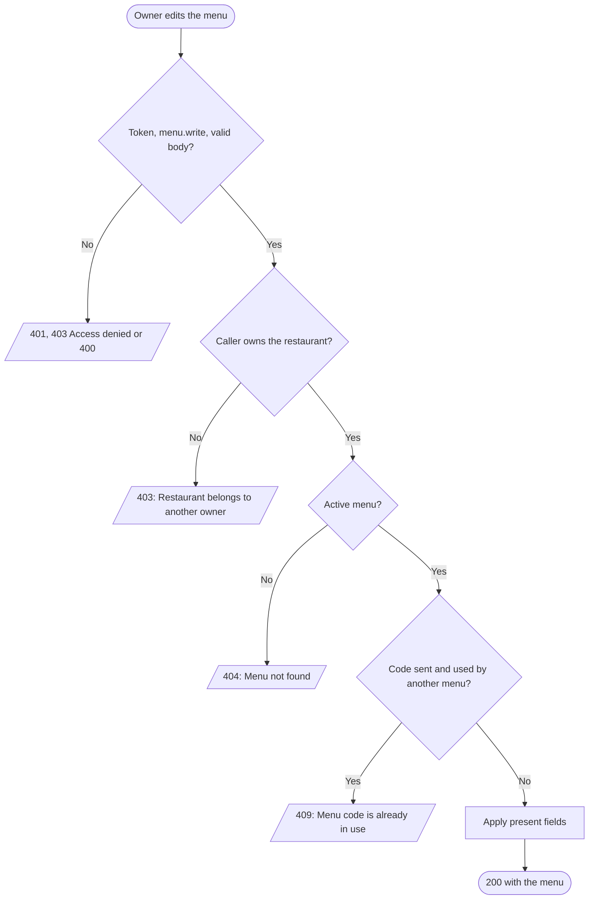
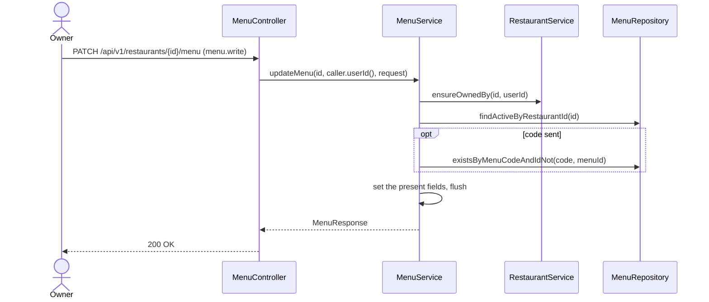

# Goal

A restaurant's owner changes its menu's code or category.

Issue [#94](https://github.com/msmohammed0077-cmd/mentorship-restaurant/issues/94), under the
Menu CRUD umbrella [#92](https://github.com/msmohammed0077-cmd/mentorship-restaurant/issues/92).
Design: [menu CRUD](../../../designs/2026-10-17-menu-crud-design.md).

## Actor

Restaurant Owner (`menu.write`, held by `RESTAURANT_OWNER`).

## Preconditions

The restaurant belongs to the caller and has a menu that is not deleted.

## Scope

`PATCH /api/v1/restaurants/{restaurantId}/menu` — **200** with the menu and its items.

Adds `UpdateMenuRequest` and `MenuService.updateMenu`.

## Business Rules

1. Only the restaurant's **owner**, checked before anything is read (as
   [create-menu](../create-menu/create-menu.md)); the admin is refused too.
2. Both fields are **optional**; absent or null leaves a field as it is.
3. The **code** must not be used by **another** menu, deleted or not: 409, "Menu code is already in
   use". Re-sending the menu's own code is accepted.
4. A **category** change shows on every item, which carries the menu's category.
5. Changes are made on the loaded menu; dirty checking writes them. The use-case flushes before it
   returns, so a racing code is answered with 409, not a 500 at commit.

## Authorisation

As [create-menu](../create-menu/create-menu.md#authorisation): a token, `menu.write`, and ownership.

## API

```http
PATCH /api/v1/restaurants/4/menu
Authorization: Bearer <owner token>
Content-Type: application/json

{ "category": "Mains" }
```

| Field | Rule |
| --- | --- |
| `code` | optional; if present not blank, max 100 |
| `category` | optional; if present not blank, max 100 |

Response, **200**: the menu, as [get-menu](../get-menu/get-menu.md#api) returns it.

## Data Model

No migration. Writes `menus.menu_code` and `menus.menu_category`.

## Main Success Scenario

1. The owner sends the fields to change.
2. The system checks the token, the permission and the body.
3. The system checks the caller owns the restaurant.
4. The system loads the restaurant's active menu.
5. If a code is sent, the system checks no other menu uses it.
6. The system applies the fields and returns 200 with the menu.

## Exception Flows

- **2a. No valid token:** 401. **2b. No `menu.write`:** 403, "Access denied". **2c. Body invalid:**
  400.
- **3a. Not the owner, or no such restaurant:** 403, "Restaurant belongs to another owner".
- **4a. No menu, the menu deleted, or the restaurant deleted:** 404, "Menu not found".
- **5a. Code used by another menu:** 409, "Menu code is already in use". Nothing changes.

## Postconditions

The menu holds the new values; `GET …/menu` shows them.

## Diagram

### Flowchart



### Sequence Diagram



## Testing

`UpdateMenuEndpointTest`, end-to-end, as the restaurant's owner unless stated.

| Case | Expected |
| --- | --- |
| Code and category, with an item on the menu | 200; the item shows the new category; stored |
| `{"code": null}` | 200, unchanged |
| Its own code | 200 |
| A seeded menu's code | 409, code unchanged |
| No menu / a deleted menu | 404 "Menu not found" |
| No token | 401 |
| `CUSTOMER` token | 403 "Access denied" |
| Another restaurant's owner / the admin | 403 "Restaurant belongs to another owner", unchanged |
| Blank code | 400 |
