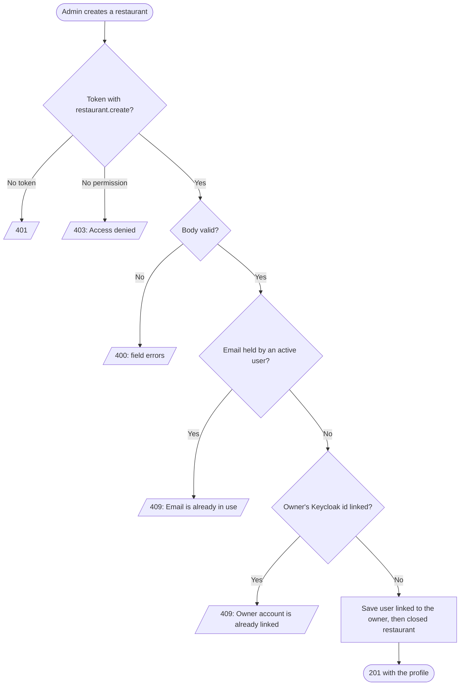
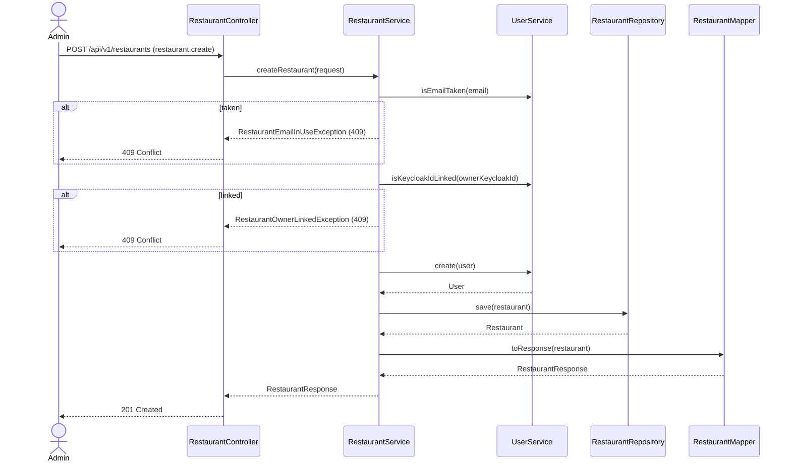

# Goal

The System Admin adds a restaurant to the platform, linked to the Keycloak user its owner logs in
with.

Issue [#86](https://github.com/msmohammed0077-cmd/mentorship-restaurant/issues/86), under the
Restaurant CRUD umbrella [#85](https://github.com/msmohammed0077-cmd/mentorship-restaurant/issues/85).
Design: [restaurant CRUD](../../../designs/2026-10-10-restaurant-crud-design.md).

## Actor

System Admin (`restaurant.create`, held by `ADMIN`).

## Preconditions

1. The admin has created the owner in Keycloak, with the `RESTAURANT_OWNER` role, and has their id.
2. No active user, customer or restaurant, holds the email.
3. No `users` row is linked to the owner's Keycloak id.

## Scope

`POST /api/v1/restaurants` — **201** with the new restaurant's profile.

Adds `CreateRestaurantRequest`, `RestaurantService.createRestaurant`, `UserService.isKeycloakIdLinked`,
`RestaurantEmailInUseException` and `RestaurantOwnerLinkedException` (both 409). `Restaurant` gains
a builder (ADR 0005).

## Business Rules

1. The **email** is lower-cased, and must not be held by an **active** user of either kind,
   compared case-insensitively — 409, "Email is already in use". A soft-deleted user's email
   is free. The partial unique index `uq_users_active_email` is the backstop.
2. The **owner's Keycloak id** must not be linked to any `users` row, deleted or not — 409, "Owner
   account is already linked". The unique constraint `uq_users_keycloak_id` covers every row and
   is the backstop.
3. The **name** is trimmed, then stored twice: as the restaurant's name and as its user's name. It
   is capped at 150 characters, `user_name`'s limit.
4. The account is **linked from the start**: `user_keycloak_id` is the owner's Keycloak id, so their
   first token resolves to this user. Login never links an existing row by email (ADR 0009), so a
   row created without the id could never be logged in to.
5. A new restaurant **starts closed** (`is_open: false`): it has no menu yet, and the owner opens it
   when ready. An `is_open` in the body is ignored. The column's `DEFAULT TRUE` stays for the seeds.
6. The owner's Keycloak id is **never** in the response.

## Authorisation

A token and `restaurant.create` are required (ADR 0008); only `ADMIN` holds it. The permission is
checked before the body reaches the service, so a refused caller cannot learn which emails or
owners are taken. `owner_keycloak_id` names the new owner, not the caller, so it does not reopen the
IDOR ADR 0009 closed. Before #83 the caller declared `?role=ADMIN`, and anyone could create
restaurants.

## API

```http
POST /api/v1/restaurants
Authorization: Bearer <admin token>
Content-Type: application/json

{
  "name": "Koshary Corner",
  "description": "Koshary, the Cairo way.",
  "email": "contact@koshary.example.com",
  "owner_keycloak_id": "6f1c2a7e-3b9d-4f5a-8c21-0d4e9b7a1c35"
}
```

| Field | Rule |
| --- | --- |
| `name` | required, not blank, max 150 |
| `description` | optional, max 1000 |
| `email` | required, valid email, max 255 |
| `owner_keycloak_id` | required, a UUID (a malformed one is 400 "Request body is malformed") |

Response, **201**:

```json
{
  "restaurant_id": 4,
  "name": "Koshary Corner",
  "description": "Koshary, the Cairo way.",
  "email": "contact@koshary.example.com",
  "is_open": false
}
```

## Data Model

No migration. One `users` row and one `restaurants` row:

| Table | Column | Value |
| --- | --- | --- |
| `users` | `user_name` | the name |
| `users` | `user_email` | the email, lower-cased |
| `users` | `user_keycloak_id` | the owner's Keycloak id |
| `restaurants` | `user_id` | the new user |
| `restaurants` | `restaurant_name` | the name |
| `restaurants` | `restaurant_description` | the description, or null |
| `restaurants` | `restaurant_is_open` | `false` |

Not stored: phone, address, opening hours. `is_open` stays a manual flag.

## Main Success Scenario

1. The admin creates the owner in Keycloak, with `RESTAURANT_OWNER`.
2. The admin sends the restaurant's name, description, email and the owner's Keycloak id.
3. The system checks the token and the permission.
4. The system validates the body (400 before the service runs).
5. The system normalises the email and checks no active user holds it.
6. The system checks no user is linked to the owner's Keycloak id.
7. The system saves the user, linked to the owner, then the restaurant, closed.
8. The system returns 201 with the profile.

## Exception Flows

- **3a. No valid token:** 401.
- **3b. No `restaurant.create`:** 403, "Access denied". Nothing is read or written.
- **4a. Body invalid:** 400, naming each failing field.
- **5a. Email held by an active user:** 409, "Email is already in use".
- **6a. Owner's Keycloak id already linked:** 409, "Owner account is already linked".

## Postconditions

A closed restaurant exists, listed by the index and readable by id. Its owner's first login resolves
to it, and `RestaurantService.ensureOwnedBy` lets them edit, open and close it.

## Diagram

### Flowchart



### Sequence Diagram



## Testing

`CreateRestaurantEndpointTest`, end-to-end, as the seeded admin unless stated.

| Case | Expected |
| --- | --- |
| Full body, mixed-case email, `is_open: true` in the body | 201, email normalised, `is_open: false`, no `owner_keycloak_id`; stored `user_name` = `restaurant_name`, `user_keycloak_id` = the owner |
| No description | 201, no `description` |
| Name with surrounding spaces | 201, name trimmed in both columns |
| No token | 401, nothing written |
| `CUSTOMER`, `RESTAURANT_OWNER` token | 403 "Access denied", nothing written |
| `RESTAURANT_OWNER` with a taken email | 403, not 409 |
| Blank name, name of 151, no email, malformed email, email over 255, email with surrounding spaces, description of 1001, no `owner_keycloak_id` | 400 naming the field |
| Malformed `owner_keycloak_id` | 400 "Request body is malformed" |
| Seeded restaurant's email, upper-cased | 409 |
| Seeded customer's email | 409 |
| Email of a soft-deleted restaurant | 201 |
| Keycloak id of a seeded customer, of the admin, of a soft-deleted restaurant | 409 "Owner account is already linked", nothing written |

Every email the test creates starts with `create.restaurant.test.`; cleanup deletes only those users,
and their restaurants go with them by cascade. `EndpointAuthorizationTest` covers the endpoint's
row in the permission matrix.

# Notes

1. **Two simultaneous creates with the same email or owner** both pass the checks; the second then
   hits `uq_users_active_email` or `uq_users_keycloak_id`, which the service answers with the same
   409. `CreateRestaurantRaceTest` covers both, as a unit test, because the window cannot be hit on
   demand over HTTP.
2. **The admin creates the Keycloak user by hand.** The API does not call Keycloak's Admin API: that
   needs its own client, credentials and a dependency. Doing it from here is a follow-up.
3. **The email may differ from Keycloak's.** Keycloak owns the login email (ADR 0010):
   `UserService.findCaller` replaces ours with the token's verified email on the owner's first
   request, unless another active account holds it.
4. **No phone, address or opening hours.** No client needs them yet.
5. **Surrounding whitespace in the email is a 400, not trimmed.** `@Email` refuses it before the
   service runs, so the service only lower-cases.
