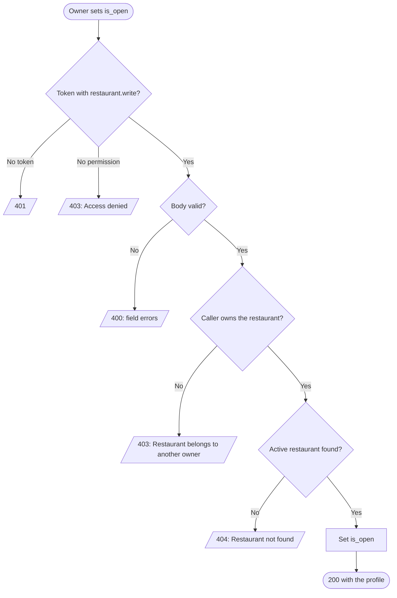
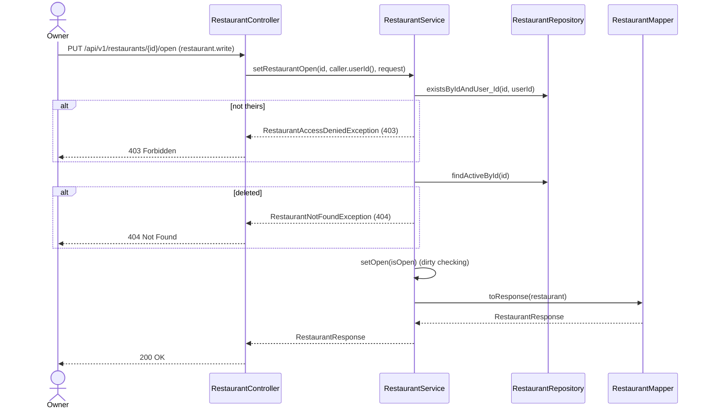

# Goal

A restaurant's owner opens it to new orders or closes it.

Issue [#91](https://github.com/msmohammed0077-cmd/mentorship-restaurant/issues/91), under the
Restaurant CRUD umbrella [#85](https://github.com/msmohammed0077-cmd/mentorship-restaurant/issues/85).
Design: [restaurant CRUD](../../../designs/2026-10-10-restaurant-crud-design.md).

## Actor

Restaurant Owner (`restaurant.write`, held by `RESTAURANT_OWNER`).

## Preconditions

The restaurant exists, is not deleted, and belongs to the caller.

## Scope

`PUT /api/v1/restaurants/{id}/open` — **200** with the profile.

Adds `SetRestaurantOpenRequest` and `RestaurantService.setRestaurantOpen`; shares
`RestaurantService.ensureOwnedBy` with [update-restaurant](../update-restaurant/update-restaurant.md).

## Business Rules

1. Only the restaurant's **owner** may open or close it, checked with
   `ensureOwnedBy({id}, caller.userId())`; anyone else is 403, "Restaurant belongs to another
   owner", **before** the restaurant is read. `ADMIN` holds `restaurant.write` but owns no
   restaurant, so it is refused too.
2. `is_open` is **required** (`true` or `false`).
3. **Idempotent**: setting the current value again is 200 and changes nothing.
4. **Closing stops new business only.** Add-to-cart and checkout refuse a closed restaurant (409,
   "Restaurant is closed"). Orders already placed carry on: accepted and preparing orders continue,
   and a `PLACED` order keeps its normal auto-reject deadline.
5. **Carts are kept.** A cart holding a closed restaurant's items stays; checkout refuses it until
   the restaurant reopens or the customer empties it.
6. `is_open` is a manual flag, not opening hours. See [Open (restaurant)](../../../glossary.md).

## Authorisation

A token and `restaurant.write` are required (ADR 0008), and the caller must own the restaurant
(ADR 0009). An id that does not exist is answered as another owner's is (403). Before #83 the caller
declared `?role=` and `?restaurantId=`, and anyone could claim to be any restaurant and close it.

## API

```http
PUT /api/v1/restaurants/4/open
Authorization: Bearer <owner token>
Content-Type: application/json

{ "is_open": true }
```

| Field | Rule |
| --- | --- |
| `is_open` | required, boolean |

Response, **200**:

```json
{
  "restaurant_id": 4,
  "name": "Koshary Corner",
  "description": "Koshary, the Cairo way.",
  "email": "contact@koshary.example.com",
  "is_open": true
}
```

## Data Model

No migration. Writes `restaurants.restaurant_is_open`.

## Main Success Scenario

1. The owner sends `is_open`.
2. The system checks the token and the permission.
3. The system validates the body (400 before the service runs).
4. The system checks the caller owns the restaurant.
5. The system loads the active restaurant.
6. The system sets the flag and returns 200 with the profile.

## Exception Flows

- **2a. No valid token:** 401.
- **2b. No `restaurant.write`:** 403, "Access denied".
- **3a. `is_open` missing:** 400.
- **4a. Not the owner, or no such restaurant:** 403, "Restaurant belongs to another owner". Nothing
  is read or written.
- **5a. The owner's restaurant is deleted:** 404, "Restaurant not found".

## Postconditions

The restaurant is open or closed as asked. Open, its items can be added to carts and checked out;
closed, both are refused with 409.

## Diagram

### Flowchart



### Sequence Diagram



## Testing

`SetRestaurantOpenEndpointTest`, end-to-end, as the restaurant's owner unless stated;
`CreateOrderEndpointTest` for the checkout guard.

| Case | Expected |
| --- | --- |
| Open a closed restaurant | 200, `is_open: true`, stored |
| Close an open restaurant | 200, `is_open: false`, stored |
| Open an open restaurant | 200 |
| No token | 401, flag unchanged |
| `CUSTOMER` token | 403 "Access denied", flag unchanged |
| Another restaurant's owner / the admin | 403 "Restaurant belongs to another owner", flag unchanged |
| Unknown id | 403, not 404 |
| The owner's own soft-deleted restaurant | 404 |
| `{}` | 400 |
| Checkout of a cart holding a closed restaurant's item | 409, "Restaurant is closed"; cart kept, no order |

# Notes

1. **A `PUT` of the flag, not open/close actions**, so a retried request is harmless.
2. **No opening hours.** `is_open` stays manual, as V6 decided; no client needs a schedule yet.
