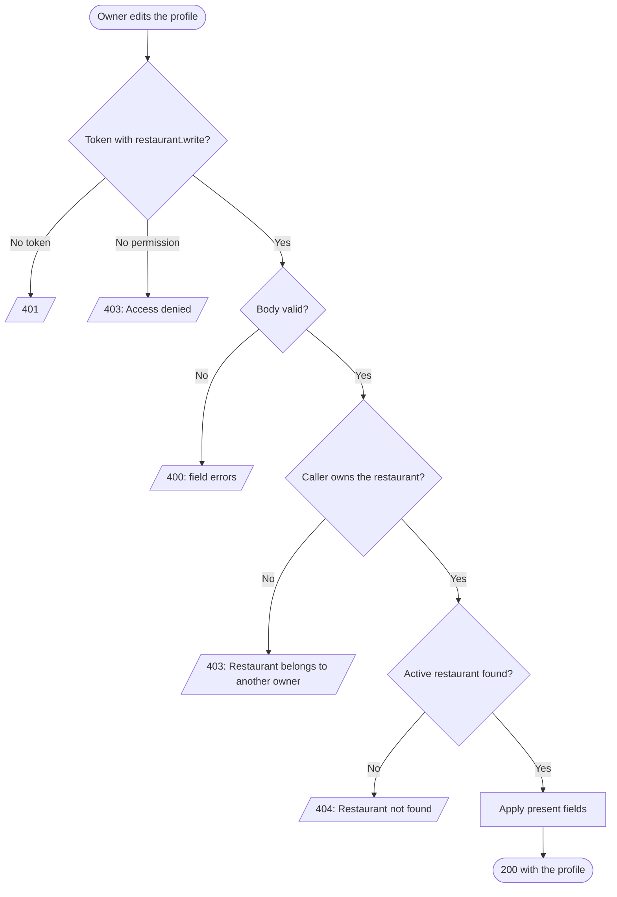
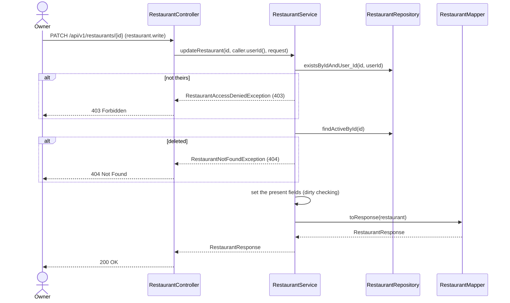

# Goal

A restaurant's owner changes its name or description.

Issue [#87](https://github.com/msmohammed0077-cmd/mentorship-restaurant/issues/87), under the
Restaurant CRUD umbrella [#85](https://github.com/msmohammed0077-cmd/mentorship-restaurant/issues/85).
Design: [restaurant CRUD](../../../designs/2026-10-10-restaurant-crud-design.md).

## Actor

Restaurant Owner (`restaurant.write`, held by `RESTAURANT_OWNER`).

## Preconditions

The restaurant exists, is not deleted, and belongs to the caller.

## Scope

`PATCH /api/v1/restaurants/{id}` — **200** with the updated profile.

Adds `UpdateRestaurantRequest` and `RestaurantService.updateRestaurant`. Ownership is
`RestaurantService.ensureOwnedBy`, which open/close and the order-status endpoints share.

## Business Rules

1. Only the restaurant's **owner** may edit it. The path `{id}` is both the restaurant edited and
   the one `ensureOwnedBy(id, caller.userId())` checks; anyone else is 403, "Restaurant belongs to
   another owner", **before** the restaurant is read. `ADMIN` holds `restaurant.write` but owns no
   restaurant, so it is refused too: nothing bypasses an ownership guard.
2. Every field is **optional**. An absent or `null` field is left as it is, so the description
   cannot be cleared here.
3. The **name** is trimmed and written to both the restaurant and its user, as at create.
4. The **email is not edited here.** Keycloak owns the login email (ADR 0010), and
   `UserService.findCaller` would replace one set through the API on the owner's next request. An
   `email` in the body is ignored.
5. The changes are made on the loaded entities; dirty checking writes them.

## Authorisation

A token and `restaurant.write` are required (ADR 0008), and the caller must own the restaurant
(ADR 0009). An id that does not exist is answered as another owner's is (403), so a caller cannot
probe which ids exist. Before #83 the caller declared `?role=` and `?restaurantId=`, and anyone could
claim to be any restaurant and edit it.

## API

```http
PATCH /api/v1/restaurants/4
Authorization: Bearer <owner token>
Content-Type: application/json

{
  "name": "Koshary Palace"
}
```

| Field | Rule |
| --- | --- |
| `name` | optional; if present not blank, max 150 |
| `description` | optional, max 1000 |

Response, **200**:

```json
{
  "restaurant_id": 4,
  "name": "Koshary Palace",
  "description": "Koshary, the Cairo way.",
  "email": "contact@koshary.example.com",
  "is_open": false
}
```

## Data Model

No migration.

| Field | Columns written |
| --- | --- |
| `name` | `restaurants.restaurant_name`, `users.user_name` |
| `description` | `restaurants.restaurant_description` |

## Main Success Scenario

1. The owner sends the fields to change.
2. The system checks the token and the permission.
3. The system validates the body (400 before the service runs).
4. The system checks the caller owns the restaurant.
5. The system loads the active restaurant and its user.
6. The system applies the present fields and returns 200 with the profile.

## Exception Flows

- **2a. No valid token:** 401.
- **2b. No `restaurant.write`:** 403, "Access denied".
- **3a. Body invalid:** 400, naming each failing field.
- **4a. Not the owner, or no such restaurant:** 403, "Restaurant belongs to another owner". Nothing
  is read or written.
- **5a. The owner's restaurant is deleted:** 404, "Restaurant not found".

## Postconditions

The restaurant's profile, and its user's name, hold the new values; the details and the index show
them.

## Diagram

### Flowchart



### Sequence Diagram



## Testing

`UpdateRestaurantEndpointTest`, end-to-end, as the restaurant's owner unless stated.

| Case | Expected |
| --- | --- |
| Name and description | 200; stored `user_name` = `restaurant_name` |
| An `email` in the body | 200, email unchanged |
| `{"name": null}` | 200, every field unchanged |
| Name with surrounding spaces | 200, name trimmed in both columns |
| No token | 401, nothing written |
| `CUSTOMER` token | 403 "Access denied", nothing written |
| Another restaurant's owner / the admin | 403 "Restaurant belongs to another owner", nothing written |
| Unknown id | 403, not 404 |
| The owner's own soft-deleted restaurant | 404 |
| Blank name, name of 151, description of 1001 | 400 naming the field |

Every email the test creates starts with `update.restaurant.test.`; cleanup deletes only those
users. `EndpointAuthorizationTest` covers the endpoint's row in the permission matrix.

# Notes

1. **Changing the email** happens in Keycloak, and reaches us through `UserService.findCaller` on
   the owner's next request.
2. **Opening and closing** is its own use-case, [set-restaurant-open](../set-restaurant-open/set-restaurant-open.md);
   an `is_open` in this body is ignored.
